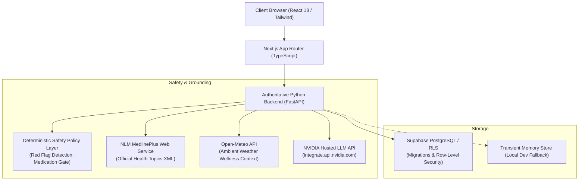

# WellSpring AI — Your Everyday Health Action Companion

> **Evidence-grounded physical wellness education, calibrated daily routines, and deterministic clinical safety triage.**

WellSpring AI is an integrated, full-stack digital health application built to bridge the gap between complex health information and sustainable daily habits. It translates reviewed health guidelines from the **U.S. National Library of Medicine (MedlinePlus)** into practical, personalized action plans without diagnostic speculation or generic AI slop.

---

## 🏛️ System Architecture



---

## 🛡️ Healthcare Safety Architecture

WellSpring AI never allows an LLM to independently evaluate whether a user's health situation is safe. A multi-stage deterministic safety engine gates every check-in:

1. **Deterministic Red-Flag Gate (P0 Emergency Triage):**
   - Scans for acute cardiovascular, respiratory, stroke, severe trauma, or anaphylaxis warning signs.
   - Scans for active crisis disclosures (suicidal ideation, self-harm).
   - If triggered: **Zero LLM tokens are spent**; the user is immediately routed to verified emergency services (**112** in India, **911** in the US) and crisis counseling (**Tele-MANAS: 14416** or **988**). No self-care advice is provided.

2. **Medication Non-Interference Gate:**
   - Explicitly rejects inquiries requesting prescription dosage alterations, medication cessation, or unauthorized pharmaceuticals.

3. **Scope & Domain Boundaries:**
   - Supported: Everyday sleep hygiene, daily stress management, desk ergonomics & posture, hydration routines.
   - Unsupported: Oncology/cancer diagnosis, pregnancy labor/complications, pediatric emergencies, pathology diagnosis.

4. **Evidence Grounding:**
   - Action recommendations are grounded directly in official MedlinePlus topics. Source citations are attached by the backend—**never fabricated by the language model**.

---

## 🔌 External Integrations & Priorities

| Integration | Priority | Endpoint / Service | Role & Behavior |
| :--- | :---: | :--- | :--- |
| **NVIDIA Hosted LLM** | P0 | `https://integrate.api.nvidia.com/v1/chat/completions` | Structured JSON guidance synthesis using `meta/llama-3.1-8b-instruct`. Graceful grounded fallback if key is absent. |
| **MedlinePlus Search API** | P0/P1 | `https://wsearch.nlm.nih.gov/ws/query?db=healthTopics` | Live NIH/NLM XML topic retrieval safely parsed with `defusedxml` and cached in-memory. |
| **Crisis Resources** | P1 | Curated National Directory | Official verified helplines: **Tele-MANAS (14416)**, **India Emergency (112)**, **KIRAN (1800-599-0019)**, **US 988/911**. |
| **Open-Meteo Weather** | P2 | `https://api.open-meteo.com/v1/forecast` | Ambient temperature and humidity for context-aware hydration and outdoor activity tips. |
| **Supabase PostgreSQL** | DB | Relational DB + Migrations | Persistent storage for action plans, action items, citations, and habit reflections with RLS. |

---

## 🚀 Quickstart & Local Setup

### Prerequisites
- Python 3.8+
- Node.js 18+ and npm

### 1. Environment Configuration
Copy `.env.example` to `.env`:
```bash
cp .env.example .env
```
Key variables:
```ini
# Backend
APP_ENV=development
BACKEND_HOST=127.0.0.1
BACKEND_PORT=8000
FRONTEND_ORIGIN=http://localhost:3000

# NVIDIA Hosted LLM (Obtain free-tier key at build.nvidia.com)
NVIDIA_API_KEY=your_key_here
NVIDIA_MODEL=meta/llama-3.1-8b-instruct

# Supabase (Optional for local transient storage)
SUPABASE_URL=
SUPABASE_PUBLISHABLE_KEY=
SUPABASE_SERVICE_ROLE_KEY=
```

### 2. Python Backend Setup & Execution
```bash
cd backend
python -m venv venv

# Windows:
.\venv\Scripts\activate
# Linux/macOS:
source venv/bin/activate

pip install -r requirements.txt

# Run test suite (25 passing unit and integration tests):
pytest -v

# Start FastAPI server:
uvicorn app.main:app --host 127.0.0.1 --port 8000 --reload
```
Backend API will be live at `http://127.0.0.1:8000`. Interactive OpenAPI documentation available at `http://127.0.0.1:8000/docs`.

### 3. Next.js Frontend Setup & Execution
```bash
cd frontend
npm install

# Build production bundle:
npm run build

# Start development server:
npm run dev
```
Access the application in your browser at `http://localhost:3000`.

---

## 🧪 Verifiable Test Suite

The backend contains **25 automated tests** covering:
- Deterministic emergency red-flag triage (cardiovascular, respiratory, stroke, self-harm)
- Medication alteration rejection
- Out-of-scope medical inquiry boundaries
- NVIDIA LLM adapter mocking, timeouts, 401 handling, and bounded retry resilience
- MedlinePlus XML parsing with `defusedxml` and HTML sanitization
- Multi-step check-in workflow and follow-up query collection
- Progress reflection and worsening symptom alerts
- FastAPI REST contracts and status codes

Run test suite:
```bash
cd backend
pytest -v
```

---

## ⚖️ Clinical Transparency & Disclaimer
WellSpring AI is an educational technology prototype designed to assist users in understanding everyday physical wellness practices and daily routines. **It is not an automated doctor, diagnostic medical device, or prescription prescribing system.** Never disregard professional clinical advice or delay seeking medical attention because of information provided by this application.
